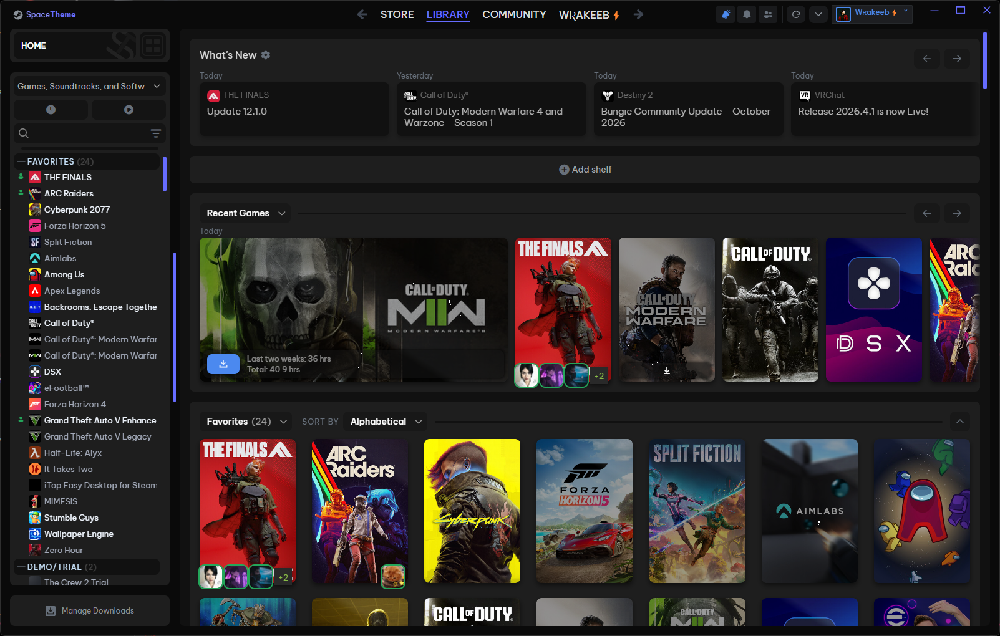
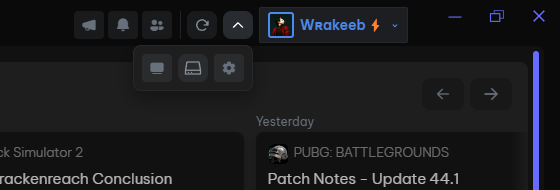
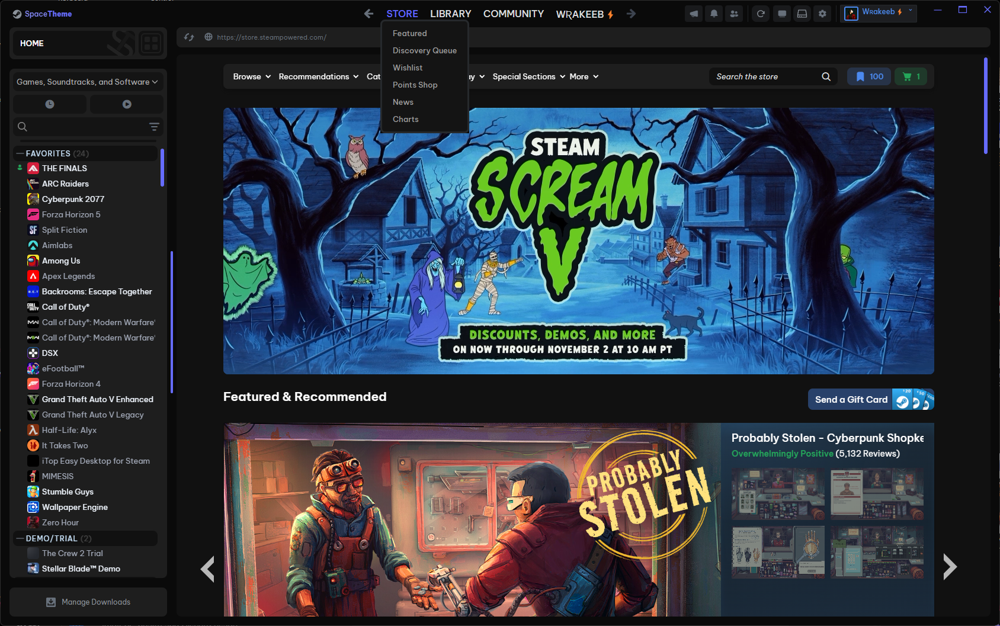
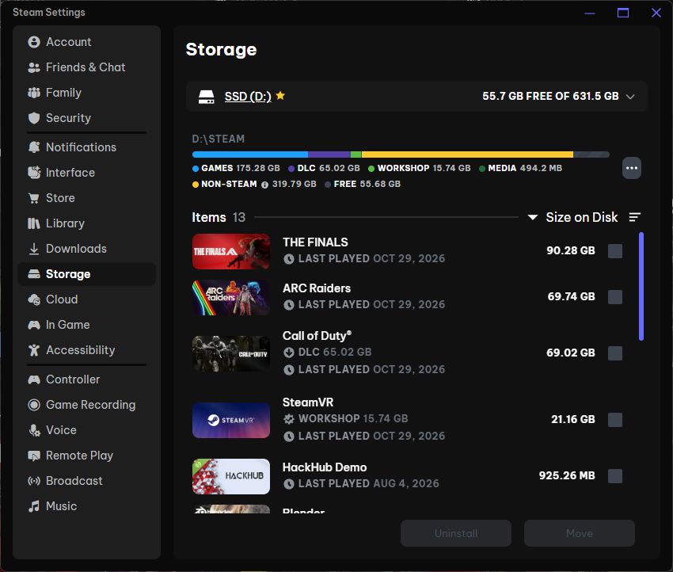

# SpaceTheme for Steam — Top Right Edition

A focused fork of [SpaceTheme/Steam](https://github.com/SpaceTheme/Steam), maintained by [w-rakeeb](https://github.com/w-rakeeb). It keeps SpaceTheme's dark styling while bringing the profile and everyday controls back to the titlebar.

## Features

- **Centered navigation:** Store, Library, Community, and profile navigation. At 1440 CSS pixels or less, navigation uses a second row to prevent overlap.
- **Compact profile:** rectangular dark surface, 24 px avatar, account name, status color, and arrow inside a 30 px box.
- **Pinned controls:** News, Notifications, and Friends & Chat stay visible. Existing hide-button settings still apply.
- **Left-opening dropdown:** at 1680 CSS pixels or less, remaining utility controls open down and to the left of the arrow. On wider windows they remain inline.
- **Reload shortcut:** uses Steam's `Browser.RestartJSContext()` to reload its interface, without intentionally exiting Steam or restarting Windows.
- **Storage shortcut:** opens Steam's native Settings → Storage page.
- **Manage Downloads icon:** restores the idle download icon without duplicating it during active downloads.
- **Original layout:** General → Userpanel → Userpanel position → **Sidebar (original)** restores the upstream profile position. **Top right** is this fork's default.

The dropdown supports clicking, Enter/Space on its button, Escape, outside-click dismissal, and keyboard focus dismissal. Original Steam elements are moved, not cloned, preserving their handlers. A focus fix prevents non-focusable icons from losing their click as the menu opens.

## Installation

### Compatibility update — 1.0.1

Updated Store navigation, event banners, personal calendar, discovery queue,
carousel indicators and playbar download information using current upstream
styles. Community home now has matching panels, search fields, tabs and loading
feedback. Missing asset/patch references and the Store-sidebar option target were
repaired. Native-only scripts no longer load on ordinary web pages; search and
friends-that-play helpers stay limited to the pages that need them. Steam's
security policy is unchanged.

The element-wait helper no longer leaves an observer behind for existing
elements, and recycled Library rows refresh their game labels. See the
[compatibility notes](docs/COMPATIBILITY-2026-11-01.md) for checks and limits.

Requires an existing [Millennium](https://steambrew.app/) installation.

1. Exit Steam normally. Back up the current theme folder and Millennium's `config/config.json` outside Steam.
2. Download the [latest release](https://github.com/w-rakeeb/SpaceTheme-Steam/releases/latest) and extract `SpaceTheme-Top-Right.zip`.
3. Copy its `Steam` folder into `<Steam>/millennium/themes/`. Replace an existing `Steam` theme only after backing it up.
4. Start Steam, open **Steam → Millennium → Themes**, and select **SpaceTheme for Steam**. Allow theme scripts/styles.
5. Set **Userpanel position → Top right** in theme settings if necessary.

Alternatively, download this repository's source ZIP and copy the folder containing `skin.json` as `<Steam>/millennium/themes/Steam`.

The folder and display names are retained so existing SpaceTheme preferences can carry over. This replaces the installed SpaceTheme copy; keep its backup to return to upstream. GitHub update metadata points to this fork.

## Plugins stay separate

**Size on Disk is not included, installed, enabled, or custom-styled by this fork.** Install plugins independently through Millennium. Steam's Storage page remains accessible through the dropdown shortcut.

## Scope and verification

The additions are CSS and a small JavaScript header module. They add no installer, native DLL, service, scheduled task, startup entry, shell command, credential store, or game-file operation. Local activation-cleanup work is not included in this repository.

Automated checks cover layout widths, centered navigation, pinned controls, left-opening position, the lost-click regression, dismissal/keyboard behavior, and shortcut dispatch. The running Windows Steam client was also used to check the visible header, profile fit, dropdown, native Storage destination, and interface reload. Screenshots above are actual captures.

This cannot guarantee against Steam or Millennium bugs. Internal classes/APIs may change. Linux, Big Picture/VR actions, mixed-DPI/multi-monitor behavior, and every upstream theme option have not been exhaustively tested. See [validation](docs/VALIDATION.md) and the [change map](docs/CHANGES.md).

## Rollback

Exit Steam and restore your backed-up theme folder and configuration. For only the profile position, select **Sidebar (original)** and reload the theme. To use default Steam, disable the theme in Millennium.

## Credits and license

Original theme/assets: **SpaceTheme / SpaceEnergy**, under the [MIT license](LICENSE). Based on upstream commit [`91a3804`](https://github.com/SpaceTheme/Steam/commit/91a380421757233340e17040fae2b866c43c2f20). The original [README](UPSTREAM-README.md) is preserved.

Customizations, testing, and Windows screenshots: **w-rakeeb**. Report fork-specific issues [here](https://github.com/w-rakeeb/SpaceTheme-Steam/issues).
